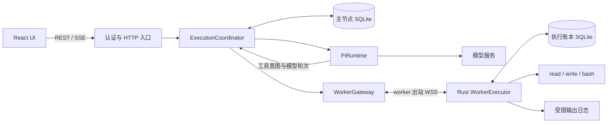

# Worker Plane MVP 最终技术方案

版本：1.0  
日期：2026-10-06  
状态：技术选型确定，可进入实施  
依据：Worker Plane MVP Spec v2，以及本次 CodebaseDesign 架构评审

## 1. 已确定的决定

- 主节点：Node.js 24 LTS、TypeScript、Fastify。
- Agent runtime：Pi SDK。Main Agent 和 Worker Session Agent 使用同一个 runtime，通过工具白名单区分。
- Worker：Rust、Tokio、rusqlite、tokio-tungstenite、rustls、nix。
- UI：React、Vite、TypeScript、TanStack Query、Tailwind CSS。
- 主数据库：SQLite WAL、better-sqlite3、显式 SQL migrations。
- 通信：worker 出站 WSS；UI 使用 REST 和可补放 SSE。
- 部署：单 Linux 主节点、Caddy、持久磁盘；worker 支持 Linux/macOS，由 systemd/launchd 管理。
- 本期不接入 Hermes、OpenCode、独立消息队列或第二种 Agent runtime。

Pi 的选型已确定，但恢复、取消和工具挂接能力仍须通过第一阶段 spike。若关键能力不满足，停止 runtime 集成并记录具体缺口，不自行换引擎，也不降低故障恢复要求。

## 2. 范围与系统保证

单用户、单主节点、多 worker，每台 worker 最多一个活动 job，每个 job 工具串行。

全部模型调用、Agent 循环和模型历史在主节点。Worker 无模型密钥、不规划下一步，只注册、执行、取消和对账。

两个入口：固定 worker/workspace 的独立会话，以及协调多机器任务的 Main Agent。用户消息和委派共用调度器。

核心保证：

1. 工具请求先落库，再发送或执行；工具结果先落库，再继续模型推理。
2. 相同 call_id 的重传不启动第二次执行。
3. 执行状态无法确认时停止推进、保留机器占用并阻塞 worker。
4. 取消和断线都不能直接证明命令已结束。
5. 会话可以恢复，不承诺任意外部命令的 exactly-once 或无缝恢复。

本期不提供机器内 job 并行、交互终端、后台服务托管、artifact 自动传输、仓库复制、工作树隔离、多租户或高可用。Bash 使用 worker 服务账号的实际权限，workspace 路径限制不构成 shell 沙箱。

## 3. 总体架构



主节点运行一个应用进程。PiRuntime 与调度器同进程，不增加 Python 或 RPC 层。SQLite 是业务状态的权威来源，内存队列和网络连接只用于唤醒与传输。

## 4. CodebaseDesign 评审结论

以“小 Interface 隐藏完整生命周期”为设计原则。调用者不需要了解执行槽、ACK、重连或 checkpoint 的顺序。

| Module | Interface | 隐藏的 Implementation |
|---|---|---|
| ExecutionCoordinator | submit、cancel、inspect、resolveAttention | FIFO、占槽、运行、委派、等待、预算、取消、恢复、终态 |
| PiRuntime | advance、abort | Pi 对象、模型消息转换、流式调用、工具捕获和 SDK 配置 |
| WorkerGateway | send、连接/协议事件订阅 | 身份认证、epoch、心跳、帧校验、连接替换和传输 |
| WorkerExecutor | accept、cancel、reconcile、acknowledge | 去重、账本、执行器占用、工具执行、进程清理、结果缓存 |
| EventFeed | snapshotCursor、subscribe | 持久事件读取、SSE 补放、断线去重与保留期限 |
| OutputStore | append、read | 分块序号、磁盘限额、截断、补读与清理 |

ExecutionCoordinator 是业务生命周期的唯一拥有者。HTTP 入口和 Pi 工具处理函数只调用它，不能分别实现排队或状态判断。WorkerExecutor 是机器执行生命周期的唯一拥有者，连接任务不能自行启动进程。

Seam 放在 Pi SDK、WSS 传输、进程执行和持久化访问处，因为这些依赖实际存在不同故障行为，需要独立验证。只实现一个 Pi Adapter 和一套 SQLite Implementation；不预建多引擎、多数据库插件体系，不为每张表增加只转发调用的通用仓库层。

## 5. 仓库结构

```text
worker-plane/
├── apps/
│   ├── server/src/
│   │   ├── http/                 # 认证、REST、SSE 入口
│   │   ├── execution/            # Coordinator、状态机、恢复、预算
│   │   ├── runtime/              # PiRuntime
│   │   ├── workers/              # Gateway、注册、workspace
│   │   ├── storage/              # SQL、事务、迁移
│   │   ├── events/
│   │   └── output/
│   └── web/src/
├── packages/
│   ├── protocol/                 # JSON Schema、生成的 TypeScript/Rust 类型
│   └── api-client/               # Web 使用的 HTTP 类型与客户端
├── worker/
│   ├── Cargo.toml
│   └── src/
│       ├── main.rs
│       ├── config.rs
│       ├── connection.rs
│       ├── protocol.rs
│       ├── executor.rs
│       ├── ledger.rs
│       ├── process.rs
│       ├── workspace.rs
│       └── output.rs
├── migrations/
├── deploy/                       # Caddy、systemd、launchd、备份
└── docs/
```

TypeScript 使用 pnpm workspace，Rust 使用 Cargo。协议类型由同一份 JSON Schema 生成并检查，禁止手工维护两套独立协议定义。依赖固定版本并提交 lockfile。

## 6. 主节点调度与数据

### 6.1 持久化

保留 spec 的 workers、workspaces、sessions、messages、jobs、tool_calls、events，补充：

| 表 | 内容 |
|---|---|
| worker_slots | worker_id 主键、active_job_id |
| runtime_checkpoints | job、已提交轮次、工具批次及执行位置、历史版本、等待条件 |
| job_dependencies | job 与必须成功的前置 job |
| attention_actions | 人工核对、放弃、解除阻塞的操作记录 |
| auth_sessions | UI 登录 session、到期与撤销状态 |

关键约束：UNIQUE(session_id, client_request_id)、UNIQUE(parent_job_id, delegation_id)、UNIQUE(job_id, call_seq)。Client request 或 delegation ID 重复但内容不同，返回冲突，不能返回旧任务掩盖参数变化。

消息保留完整模型内容与关联关系；流式草稿不作为已提交历史。Workspace 保存配置版本、规范化 repo_id 和路径。取消标记独立持久化，不能只靠 job 的展示状态表达。

SQLite 启用 WAL、foreign_keys、busy_timeout 和 synchronous=FULL。网络、模型请求及进程等待不进入数据库事务。文件和数据库备份有权限与保留期限。

### 6.2 排队与执行槽

提交消息事务内创建 job 和队列序号。按 worker FIFO 选取队首，同时保证同一 session 按消息顺序执行。离线任务允许入队，显示等待上线。

短事务完成：检查 worker 已对账且未 blocked、检查 session 可推进、占用 worker_slots、标记 running。提交后才加载历史并调用 Pi。

Worker job 从推理开始占槽；waiting_worker、cancel_requested、needs_attention 保留槽。确定无在途工具或残留进程后才能释放。Main job 不占 worker 槽，但同一 main session 只推进一个 job。

事件触发调度，并使用低频扫描处理超时和遗漏唤醒。排队等待上线默认 24 小时；未决调用不因该期限过期释放槽。

主节点必须有进程单实例锁，避免两个进程同时执行模型轮次。重启后先逐机对账，再逐机开放调度。

### 6.3 状态与预算

Job 使用 spec 的 queued、running、waiting_worker、waiting_children、cancel_requested、succeeded、failed、cancelled、needs_attention。

总执行时限从首次 running 开始计时，包含执行期间断线与子任务等待，重启不重置。排队等待期限单独计算。预算到期停止新模型/工具，正在执行的工具按取消机制处理；终止无法确认则 needs_attention。

每个 job 配置工具次数、模型 token 和执行时限；根任务另设共享模型总预算，父子调用均计入，防止通过委派绕过限制。达到预算不能依靠模型自行停止。

## 7. PiRuntime 与历史恢复

PiRuntime 是项目内部 Module，不承诺以下名称为 Pi 原生接口：

```ts
type AdvanceResult =
  | { kind: 'assistant_turn'; message: AssistantMessage; calls: ToolIntent[] }
  | { kind: 'final'; message: AssistantMessage };

// advance 接收已提交历史、工具白名单和预算；文本增量通过事件回调上报。
// abort 停止模型请求。是否接受返回值由 Coordinator 的运行代次决定。
```

PiRuntime 必须在工具实际执行前返回完整工具意图或等待 Coordinator 授权。不能只依靠执行后的 callback 补记工具。

每轮流程：

1. 从数据库加载获得执行资格的 job 历史。
2. 调用 Pi，显示带轮次 ID 的流式草稿。
3. 完整 assistant 消息、全部工具意图、稳定 ID 和 checkpoint 在一个事务中提交。
4. Coordinator 串行执行工具；结果与工具消息同事务提交。
5. 全批次完成后进入下一模型轮次，或完成 job。

模型一次返回多个工具调用时，全部持久化并串行执行，包括 read。取消导致剩余工具不执行时，保留调用历史，使用明确的未执行结果完成必要的历史配对，不能伪造 worker 执行结果。

每次推理带运行代次。取消、恢复或替代后，旧推理返回的数据不能提交工具或终态。

Pi 内部历史不是权威存储。自动上下文压缩若启用，需持久化压缩结果、来源范围和版本，保留原始完整消息；无法恢复这些信息时不启用自动压缩，超过上下文限制则明确停止。

恢复规则：未提交的模型轮次可以重试，草稿标为中断；已提交工具意图从 checkpoint 继续；未决调用先对账；已存在结果不重复追加。取消和终态 job 不恢复执行。

## 8. Main Agent 委派

Main Agent 仅暴露 list_workers、delegate、get_job。Worker Session Agent 仅暴露远程 read、write、bash。模型不能修改 worker/workspace 绑定。

delegate 的 job 创建、子 session 创建、幂等记录和事件在同一事务提交。parent_job_id、delegation_id 由已提交工具身份派生或注入；模型不能指定任意父任务。子 session 始终独立，不共享默认会话或隐藏记忆。

同一模型轮次的本地协调工具串行处理完后，有未完成子任务则保存等待集合并进入 waiting_children，不继续轮询模型。子任务结果落库与完成事件同事务提交，满足等待条件后恢复父历史。重启扫描数据库重建等待，不依赖内存订阅。

为了明确执行依赖，delegate 可接受 depends_on_job_ids；Coordinator 验证属于同一根任务且无循环。前置任务未终态时不占执行槽、不给 worker 排队；全部成功后才加入 worker FIFO。前置失败、取消或 needs_attention 时禁止启动依赖任务。

主 job 取消会请求取消所有尚未终态子任务，等待实际执行结束。子任务存在不确定执行时，父任务也不能宣称已安全取消。Main Agent 不能在子任务仍未结束时将父 job 标为 succeeded。

最终结果包含 outcome、summary、证据 call_id、必要 exit_code、错误与截断标记。succeeded 表示任务目标完成；模型的判断保留证据，不视为通用正确性证明。

## 9. Rust WorkerExecutor

### 9.1 技术与并发结构

| 用途 | 选型 |
|---|---|
| 异步与 channel | Tokio |
| 出站 WSS | tokio-tungstenite、rustls |
| SQLite | rusqlite，bundled SQLite |
| 子进程与 Unix 操作 | tokio::process、nix；按需使用 rustix 的目录句柄操作 |
| 配置与命令行 | TOML、clap |
| 序列化 | serde、serde_json |
| 日志 | tracing、tracing-subscriber |
| 请求 hash | SHA-256 |

单执行控制循环拥有活动调用、取消和启动权限。连接任务、stdout/stderr 读取任务、超时任务通过有界 channel 报告。同步 SQLite 在专用线程运行；控制循环等待持久化确认后再执行相应动作。

Worker 数据目录加独占锁，禁止两个服务实例共享账本或同时执行。Rust 类型表达 accepted、running、finished、unknown；从数据库加载时仍校验状态完整性。

### 9.2 账本与启动顺序

账本包含 calls、job_watermarks、ledger_meta、log_segments。ledger_id 在账本初始化时生成并持久化；boot_id 每次进程启动变化。

顺序：校验身份/代次/目标/容量 → accepted 落库 → 上报状态 → running 落库 → 启动执行 → 最终结果落库 → 发送结果 → 等待 result_ack。

accepted/running 与进程启动之间存在崩溃窗口。重启后无法证明未执行、已结束或安全清理时返回 unknown，不能仅根据 accepted 推断可以重跑。

重复 call_id、相同 hash：返回已有状态或结果；不同 hash：冲突。即使主节点错误发送第二个活动调用，worker 也拒绝启动。

### 9.3 工具约束

- read：有界 UTF-8 文本读取，明确 offset 单位、总长度和截断信息；二进制拒绝。
- write：最多默认 1 MiB；expected_hash 比较当前文件原始字节，临时文件写入并同步后原子替换，必要时同步父目录；保持既有文件权限，临时文件失败后清理。
- read/write 使用目录句柄和拒绝越界的路径解析，不能仅用 canonicalize 后再次按字符串打开。并发外部文件修改不属于任意事务性文件系统保证。
- bash：固定非交互 shell、配置的环境、workspace cwd，stdin 关闭，无 PTY。默认 600 秒，上限 1800 秒；调用参数和协议超时必须一致。
- 进程独立进程组；取消/超时发送 TERM，宽限后 KILL，等待退出并核查受控进程。PID 不是跨重启的可靠身份；无法安全识别残留进程时阻塞，不能按陈旧 PID 直接杀进程。
- 命令正常退出且 exit_code 非零仍是 completed；工具启动或校验异常为 failed。
- 不能确认终止为 unknown；不承诺控制刻意脱离进程组的进程。

write 的 expected_hash 是冲突检测，不承诺与任意外部写入者之间的原子 compare-and-swap；需要更强隔离时另行引入工作树或锁。

## 10. 协议与恢复

### 10.1 帧与身份

保留 spec 全部帧，均带 protocol_version；tool_result 等结果帧还需包含 job_id、call_id。Schema 校验、消息大小、工具参数和合法状态转移在两端检查。

Worker token 绑定 worker_id，Authorization header 认证 WSS。连接替换由服务端递增 connection_epoch；worker 将代次切换和接收判定串行处理，旧连接不能接受新调用。已接受调用不会因换连接自动失效。

注册补充 ledger_id、workspace 配置版本；register_ack 明确 epoch 与 reconciliation_required。对账完成前 worker 保持不可调度。

WorkerGateway 使用专用 `/ws/worker` 入口，升级时校验绑定 worker_id 的 token。Worker 连接与浏览器 REST/SSE 的认证和广播集合分开：worker 不能调用用户接口或订阅其他 worker/session 的事件；浏览器不直接访问 worker。身份由服务端校验后绑定，不能信任帧中自报的 worker_id。

连接所有权由 connection_epoch 表达，执行所有权由数据库 worker_slots 表达。心跳超时或连接替换只失效旧连接的新派发权限，不证明旧调用停止，不释放在途执行槽。旧连接的结果只可作为待对账证据，必须核对 job/call、请求 hash 和账本身份后幂等归并，不能恢复旧连接调度权限。

MVP 仅实现 WSS。注册、ACK、resume/reconcile 和 fence（拒绝旧代次新调用）规则定义在协议契约中，不依赖 socket 对象或连接存活作为业务事实。未来增加其他传输时必须复用这些规则；本期不增加 long polling 或独立 lease 服务。

### 10.2 请求 hash 与水位

按 RFC 8785 规范化 JSON 后计算 SHA-256，两端用固定样例验证。hash 覆盖 call_id、call_seq、job/session、worker/workspace、workspace 版本、工具内容和超时，不包含 connection_epoch 或传输时间。

result_ack 仅在主节点结果事务提交后发送。Worker 保存每 job 已确认序号下界，拒绝下界之前的过期调用。详细结果可清理，但不因删除 job 历史删除最低去重证明；保留小型 job tombstone/watermark，防止旧帧复活执行。需要整体清空账本时更换 ledger_id 并重新人工核对。

### 10.3 Workspace 绑定

Session 固定绑定 worker_id、workspace_id，以及创建时目录/repo 身份。Job 记录已校验的配置版本。配置变化在运行中不改绑当前 job；后续 job 重新校验，目标目录或明确 repo 要求变化时拒绝，要求显式重新绑定或新建会话。

协议拒绝模型提供任意 cwd。Worker 配置决定实际目录，repo_id 仅用于路由检查，不构成权限证明。

### 10.4 对账决策

| 事实 | 动作 |
|---|---|
| 已持久化完成 | 重传缓存结果，主节点幂等保存 |
| 同 boot 正在运行 | 恢复观察，不重新启动 |
| 同一可信 ledger 可证明从未接受 | 同 call_id、原始执行内容重传 |
| ledger 变化、记录矛盾或终止不明 | needs_attention，worker blocked |

主节点重启先恢复 checkpoint、执行槽和父子关系。Worker 重启对 accepted/running 核查，已完成结果可重传，不承诺恢复在途命令。

人工动作分开：记录核对结果、放弃 job、确认残留已终止后解除阻塞、新建重试 job。放弃不解除阻塞，解除必须保存依据。重试使用新 ID，提示核对已有副作用。

## 11. 取消

queued 任务事务内 cancelled。推理中持久化取消并 abort，旧代次结果不再产生调用。工具中持久化请求并发送幂等 cancel_call。

cancel_ack 仅表示收到请求；最终 tool_result 或可靠人工核对才证明执行结束。离线保持请求，重连先对账和取消，再开放调度。

执行完成与取消竞争时保留真实工具结果和副作用，禁止后续调用；已经终态的 job 返回原状态。没有活动工具、残留执行已确认结束后才能推进下一任务。

## 12. UI、日志与认证

UI 提供 Main Agent、worker 列表、独立会话、机器时间线、委派卡片、排队位置、取消和 needs_attention 处置。追问排队，本期没有实时 steering。

REST 提供 spec 的会话、消息、job、取消和日志接口，补充登录/退出与明确的人工核对接口。消息提交返回 job_id；创建 worker session 必须指定目标。

SSE 用单调 event_id 补放，支持 Last-Event-ID 或 after。UI 先取带游标的快照，再订阅后续事件；事件保留到期则要求重新加载快照。鉴权必须同样适用于事件和日志。

完整业务消息、工具结果和关键事件同事务提交。模型文本增量可按小批次持久化为有轮次 ID 的草稿；最终提交后成为正式消息，重启未完成草稿标为中断。

输出按 call_id、stream、seq 分块：worker 限额落盘，主节点保留受限缓存供离线查看。数据库存结果和日志索引，避免每个 stdout 分块形成永久业务事件。两端输出队列满或触限时继续排空管道、明确记录缺口与截断，不能让输出阻塞命令。

默认每流模型结果 64 KiB、单调用日志总计 10 MiB，账本与日志另设总磁盘预算。未确认结果不得清理；补读 ACK 与 tool result ACK 分开，日志已过期明确提示。主节点流量与磁盘预算也必须有限。

单用户采用预配置管理员账号、Argon2id 密码 hash、服务端登录 session；Cookie 为 Secure、HttpOnly、SameSite，变更请求校验 Origin/CSRF。登录限速，不开放匿名派发。

Worker token 高熵、独立、可撤销，数据库只存安全校验值。撤销立即关闭现有连接并禁止新派发，不代表在途命令已结束；恢复对账需显式配置新的有效 token。模型密钥仅存在主节点配置中。

### 12.1 数据外流边界

“执行在本地”不等于数据不出机器：工具参数、输出和转写都会到主节点并发往模型供应商。中心数据按源码级敏感数据管理（高 = 含源码、命令输出或凭据；中 = 机器拓扑与元数据；低 = 计数与状态）。

| 边界 | 数据 | 中心存储 | 级别 |
|---|---|---|---|
| worker → 主节点（WSS） | register 帧：worker_id、boot_id、ledger_id、workspace path 与 repo_id | workers、workspaces、sessions.path/repo_id | 中 |
| | tool_result：read 返回的文件内容、write 的 hash/字节数、bash 退出码与每流前 64 KiB（`MODEL_STREAM_BYTES`） | runtime_calls.result_json | 高 |
| | tool_log / log_fetch：bash 完整 stdout/stderr，worker 每调用最多 10 MiB（`CALL_LOG_LIMIT`） | call_logs.data，主节点总量默认 1 GiB（`MAIN_LOG_CAPACITY_BYTES`），超出部分只记 main_truncated | 高 |
| | Worker token（连接认证） | worker_tokens 只存 digest | 高 |
| 主节点 → worker | tool_call：工具名与参数（命令、路径、写入全文） | runtime_calls.arguments_json | 高 |
| 主节点 → 模型供应商 | 系统提示、用户输入、完整历史（含工具参数与 64 KiB 结果视图）；模型密钥作为 API key | messages/runtime_turns/runtime_history、jobs.input_text、runtime_checkpoints；`DATA_DIR/pi-sessions/<session>` 由 Pi SessionManager 管理（是否落盘全文 待核实） | 高 |
| | 供应商默认 openrouter（`MODEL_PROVIDER`/`MODEL_NAME`），密钥来自 `MODEL_API_KEY` 环境变量；Pi 另有 `DATA_DIR/pi-auth.json` 路径（是否写入密钥 待核实）。供应商侧留存策略 待核实 | 不入库 | 高 |
| 浏览器 ↔ 主节点（HTTPS/SSE） | 管理员密码（仅登录请求）、session Cookie 与 CSRF；会话、消息、工具结果、日志、事件 | administrators.password_hash（Argon2id）、auth_sessions.digest/csrf、events.content_json | 高 |
| 磁盘：主节点 | `DATA_DIR` 下 SQLite（含 WAL）及其备份即全部上述中心数据 | 同上；备份权限与保留期见 6.1，具体策略 待核实 | 高 |
| 磁盘：worker | 账本与 `data_dir/logs/<sha256(call_id)>/{stream}.log/.idx` | 不外流，按保留期清理 | 高 |
| 进程日志 | Fastify 请求日志脱敏 authorization、cookie；execution 失败 console.error 只打印错误串（是否可能含工具内容 待核实） | 由 systemd/journald 收集 | 中 |

不离开 worker 的数据：

- Worker token：从 `WORKER_TOKEN` 读取（`token_file` 与重连重读见 feat/worker-token-file，合入前 待核实），只在连接认证时发送，主节点存 digest。
- 工具子进程环境：bash 以 `env_clear()` 启动，只保留固定 PATH 与 HOME（worker/src/process.rs、worker/src/tools.rs），worker 自身环境变量不会进入命令输出。
- 超出 10 MiB 的输出只计数不存；workspace 中未被 read 或命令打印的文件内容不上传，但模型可经 read/bash 读取任意 workspace 内文件，因此 workspace 内全部内容都应视为可外流。
- 模型密钥与管理员凭据不下发给 worker。

## 13. 部署与运维

主节点：Caddy + 常驻 Node 应用 + 本地 SQLite 和日志目录。Caddy 配置 WSS 升级、SSE 无缓冲及合适的长连接超时。应用受 systemd 管理，健康检查区分进程存活与调度就绪。

Worker：Linux systemd、macOS launchd；配置、账本与日志分目录保存，账号使用必要权限。Rust 发布各平台原生二进制，使用平台 CI 构建；不依赖未经验证的跨平台交叉编译。

主节点使用 SQLite 在线备份并保留必要日志索引。恢复旧备份不是普通进程重启：先暂停所有 worker，核对账本和已发生执行，不能因为备份缺少调用记录而启动新任务。

记录 worker/job/call/session/运行代次，脱敏 token 和模型密钥。升级前备份、执行版本化迁移；协议不兼容拒绝连接，禁止静默解释新旧帧。

## 14. 实施与验收

详细开发阶段、交付物和验收门槛见[开发阶段与验收标准](development-plan.md)。下表是总体里程碑摘要。

| 阶段 | 内容 | 出口条件 |
|---|---|---|
| 1 | PiRuntime spike、模型历史与工具截获 | 无本地工具，完整工具意图先落库，取消与恢复可验证 |
| 2 | 单 worker、固定 workspace、队列、基本 UI | 真实任务只在指定目录执行，每机串行 |
| 3 | 账本、去重、对账、取消、主节点恢复 | 断线与崩溃不重复副作用，不确定执行阻塞 |
| 4 | Main Agent、独立子会话、持久化等待、依赖 | 子任务失败禁止依赖执行，父任务恢复不重复委派 |
| 5 | 双 worker、Linux/macOS、安装与运维 | Spec v2 全部 14 项验收通过 |

验证跨公开 Interface 进行，优先真实 SQLite、真实子进程与可控断线；模型可用脚本化 Adapter 注入轮次，故障发生在实际提交/发送/启动窗口。不能仅检查 mock 调用次数。

必须覆盖：accepted ACK 丢失、结果发送丢失、结果已落库但 ACK 丢失、启动窗口崩溃、取消与完成竞争、旧连接残留帧、worker 配置变化、账本丢失、父等待重启、超限输出、磁盘不足、主节点备份回退。

Pi spike 不包含真实 worker 副作用；必须验证多个工具的串行执行、完整历史重建、历史中的取消结果、最大步数与 token 预算。不能把 SDK 宣称的恢复功能当验收证据。

## 15. 最终评审结果

方案可以实施。CodebaseDesign 评审后的调整是：生命周期集中到 Coordinator/WorkerExecutor；Pi 留在主节点同进程；数据库为唯一业务事实来源；加入账本身份、运行代次、workspace 配置版本和持久等待；明确 ACK、取消、清理与备份恢复的不同语义。

唯一前置技术验证是 PiRuntime spike。其余队列、协议、Rust worker 与 UI 可以按确定的 Interface 开发。MVP 不增加第二种 runtime 或不必要的抽象层。
